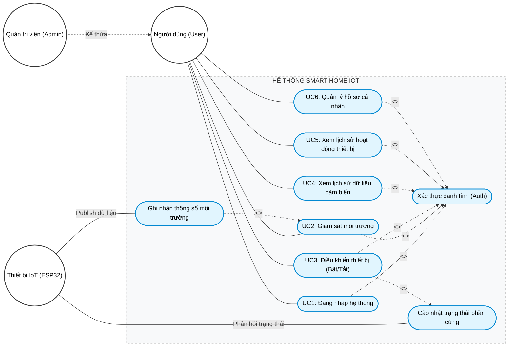
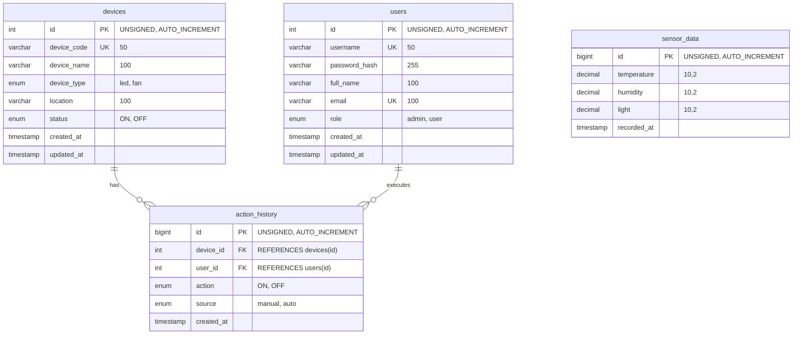
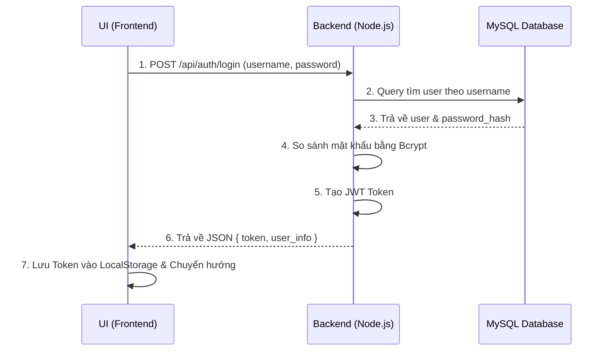
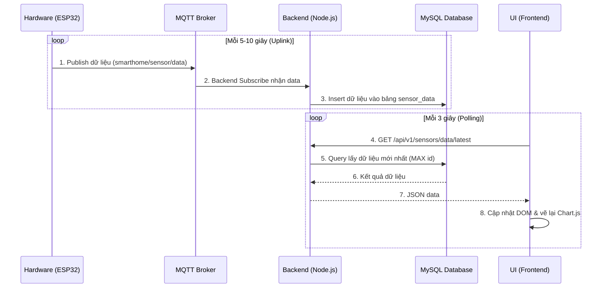
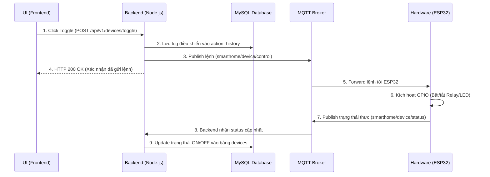
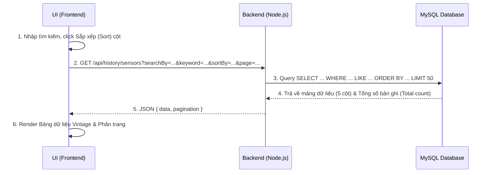
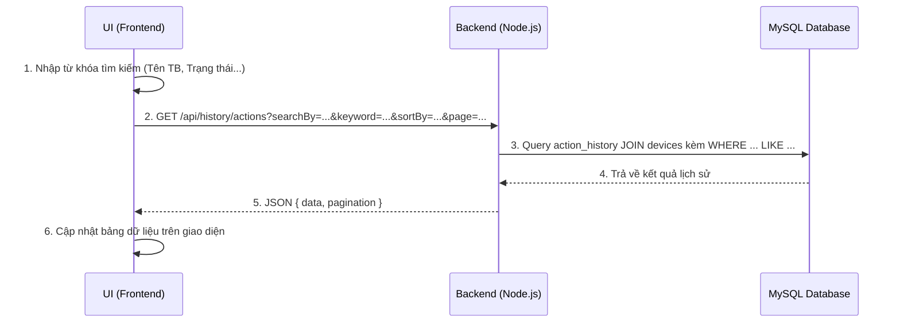
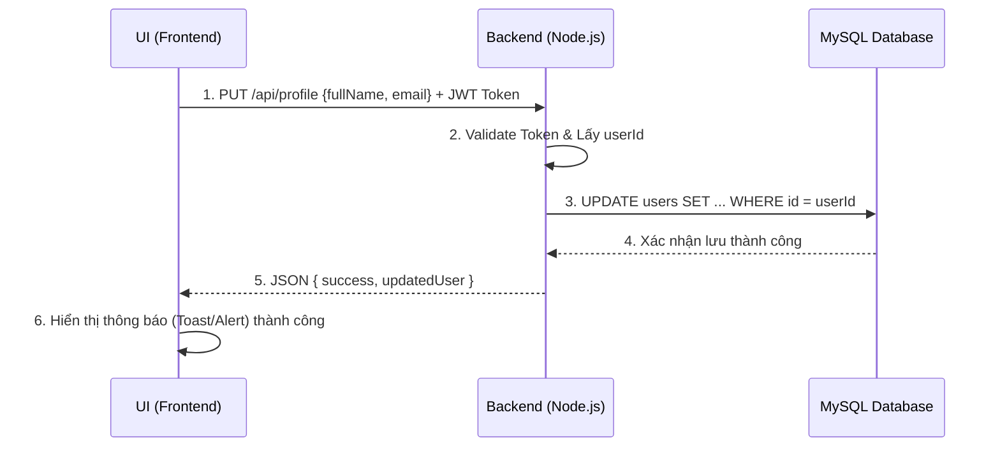

# BÁO CÁO TIẾN ĐỘ
**BÀI 1: THIẾT KẾ HỆ THỐNG VÀ CƠ SỞ DỮ LIỆU**

---

## MỤC TIÊU
Xây dựng tài liệu đặc tả, bản vẽ kiến trúc và thiết kế nền tảng dữ liệu cho toàn bộ hệ thống IoT Smart Home. Bài báo cáo này trình bày chi tiết về quy trình phân tích yêu cầu (Use Case), thiết kế giao diện (UI/UX), cấu trúc cơ sở dữ liệu (Database Schema), luồng hoạt động (Sequence Diagram) và đặc tả giao tiếp (API Documentation).

---

## 1. MÔ TẢ USE CASE (CA SỬ DỤNG)

Hệ thống được phân tích và thiết kế với 6 Use Case cốt lõi nhằm đáp ứng đầy đủ nhu cầu giám sát và điều khiển nhà thông minh.

| Mã UC | Tên Use Case | Tác nhân (Actor) | Mô tả nghiệp vụ |
|---|---|---|---|
| **UC1** | Đăng nhập hệ thống | User, Admin | Nhập username và password để xác thực và nhận JWT Token truy cập hệ thống. |
| **UC2** | Giám sát môi trường | User, Admin | Theo dõi các thông số môi trường (Nhiệt độ, Độ ẩm, Ánh sáng) trên Dashboard với dữ liệu cập nhật liên tục (Near real-time). |
| **UC3** | Điều khiển thiết bị | User, Admin | Bật/tắt các thiết bị ngoại vi (Đèn, Quạt) thông qua các công tắc điều khiển trên giao diện UI. |
| **UC4** | Xem lịch sử dữ liệu cảm biến | User, Admin | Tra cứu sự biến thiên của các thông số môi trường trong quá khứ, hỗ trợ phân trang, tìm kiếm và sắp xếp. |
| **UC5** | Xem lịch sử hoạt động thiết bị | User, Admin | Kiểm tra lại lịch sử bật/tắt thiết bị (Ai thao tác? Thời gian nào? Bật bằng tay hay tự động?). |
| **UC6** | Quản lý hồ sơ cá nhân | User, Admin | Xem và cập nhật các thông tin cá nhân (Họ tên, Email liên hệ). |

> **[CHỖ TRỐNG - CHÈN ẢNH 1]**: *Hãy chèn hình ảnh Biểu đồ Use Case Diagram tổng quát của hệ thống (vẽ bằng Draw.io hoặc StarUML) vào đây.*
> 

---

## 2. THIẾT KẾ UI/UX

Giao diện Frontend được thiết kế theo hướng tối giản, hiện đại (Minimalist & Modern), đảm bảo tính tương tác cao. Toàn bộ hệ thống áp dụng phong cách thiết kế **Vintage / Retro** (sử dụng phông chữ máy đánh chữ cổ điển, màu nền sepia). Bản vẽ thiết kế (Mockup/Prototype) được thực hiện trên nền tảng **Figma** ([Xem bản vẽ Figma Prototype](https://www.figma.com/design/Rvp8ZF9YWmAVHasuFuoUUV/HTML-to-Figma--Community-?node-id=0-1&t=7ZkeueLaBrYHYakL-1)) với các màn hình chính:

* **Màn hình Đăng nhập (Login Screen - UC1):** Màn hình xác thực danh tính phong cách Retro cổ điển, cho phép User/Admin đăng nhập vào hệ thống an toàn qua JWT Token.
* **Dashboard & Menu (Trang chủ - UC2, UC3):** Thiết kế dạng Single Page Application (SPA) đa Tab với thanh Navbar điều hướng mượt mà, hiển thị thông tin User đang đăng nhập và nút Đăng xuất.
  - Bố cục chia 2 phần: Trái (thẻ thông số cảm biến và Biểu đồ Chart.js thời gian thực), Phải (Công tắc Toggle điều khiển thiết bị).
* **Trang Data Sensor (UC4):** Thiết kế dạng Data Table 5 cột (ID, Nhiệt độ, Độ ẩm, Độ sáng, Thời gian). Tích hợp thanh công cụ (Toolbar) hỗ trợ tìm kiếm theo từng cột hoặc tất cả, sắp xếp (Sort Tăng/Giảm) và phân trang 50 bản ghi/trang.
* **Trang Active History (UC5):** Bảng lịch sử bật/tắt gồm 4 cột (ID, Thiết bị, Trạng thái, Thời gian), có thanh công cụ tìm kiếm, sắp xếp và phân trang 20 bản ghi/trang.
* **Trang Hồ sơ cá nhân (Profile - UC6):** Giao diện xem thông tin tài khoản (Username, Role) và form cập nhật Họ tên, Email liên hệ.

> **[CHỖ TRỐNG - CHÈN ẢNH 2.1]**: *Hãy chèn hình ảnh Màn hình Đăng nhập (Login) vào đây.*
> 

> **[CHỖ TRỐNG - CHÈN ẢNH 2.2]**: *Hãy chèn hình ảnh thiết kế UI trang Dashboard vào đây.*
> 

> **[CHỖ TRỐNG - CHÈN ẢNH 2.3]**: *Hãy chèn hình ảnh thiết kế UI trang Lịch sử & Dữ liệu cảm biến vào đây.*
> 

> **[CHỖ TRỐNG - CHÈN ẢNH 2.4]**: *Hãy chèn hình ảnh thiết kế UI trang Hồ sơ cá nhân (Profile) vào đây.*
> 

---

## 3. THIẾT KẾ CƠ SỞ DỮ LIỆU (DATABASE DESIGN)

Hệ quản trị CSDL được lựa chọn là **MySQL** với chuẩn thiết kế tên bảng/cột là `snake_case`. Lược đồ (Schema) bao gồm 4 bảng chính, có tính toàn vẹn dữ liệu cao (ràng buộc Khóa ngoại - Foreign Key rõ ràng).

1. **Bảng `users`**: Lưu trữ tài khoản đăng nhập (Phân quyền Role: admin/user, Password mã hóa Bcrypt).
2. **Bảng `devices`**: Danh mục các thiết bị vật lý có thể điều khiển (Mã thiết bị, Tên, Trạng thái ON/OFF thực tế).
3. **Bảng `sensor_data`**: Bảng dữ liệu chuỗi thời gian (Time-series data) lưu lịch sử các chỉ số môi trường. Bảng được thiết kế phẳng (Flattened Schema) với các cột `temperature`, `humidity`, `light` trên cùng một hàng để phục vụ truy vấn tối ưu cho giao diện bảng 5 cột. Áp dụng Index trên trường thời gian.
4. **Bảng `action_history`**: Ghi log mọi hành động điều khiển (Bật/Tắt) của người dùng hoặc hệ thống, có liên kết với bảng `users` và `devices`.

> **[CHỖ TRỐNG - CHÈN ẢNH 4]**: *Hãy chèn hình ảnh Sơ đồ Thực thể Liên kết (ERD - Entity Relationship Diagram) hoặc ảnh chụp từ chức năng Reverse Engineer của MySQL Workbench vào đây.*
> 

---

## 4. THIẾT KẾ LUỒNG HOẠT ĐỘNG (SEQUENCE DIAGRAM)

Theo yêu cầu nghiệp vụ, hệ thống bao gồm 6 biểu đồ tuần tự (Sequence Diagram) tương ứng với 6 Use Case cốt lõi nhằm làm rõ quá trình giao tiếp giữa các thành phần (Frontend, Backend, Database, MQTT, và Hardware).

### 4.1. UC1: Đăng nhập hệ thống
Mô tả luồng xác thực danh tính người dùng và cấp phát Token.

> **[CHỖ TRỐNG - CHÈN ẢNH 5.1]**: *Chèn ảnh Sequence Diagram UC1 vào đây.*
> 

### 4.2. UC2: Giám sát môi trường thời gian thực
Mô tả luồng dữ liệu liên tục từ cảm biến lên Server và Frontend liên tục lấy về để vẽ biểu đồ.

> **[CHỖ TRỐNG - CHÈN ẢNH 5.2]**: *Chèn ảnh Sequence Diagram UC2 vào đây.*
> 

### 4.3. UC3: Điều khiển thiết bị
Mô tả luồng người dùng bật/tắt thiết bị, ghi log và đồng bộ với phần cứng vật lý.

> **[CHỖ TRỐNG - CHÈN ẢNH 5.3]**: *Chèn ảnh Sequence Diagram UC3 vào đây.*
> 

### 4.4. UC4: Xem lịch sử dữ liệu cảm biến
Mô tả quá trình tra cứu, lọc và phân trang dữ liệu cảm biến quá khứ.

> **[CHỖ TRỐNG - CHÈN ẢNH 5.4]**: *Chèn ảnh Sequence Diagram UC4 vào đây.*
> 

### 4.5. UC5: Xem lịch sử hoạt động thiết bị
Mô tả quá trình tra cứu, tìm kiếm và sắp xếp lịch sử các lần bật/tắt thiết bị của các tài khoản.

> **[CHỖ TRỐNG - CHÈN ẢNH 5.5]**: *Chèn ảnh Sequence Diagram UC5 vào đây.*
> 

### 4.6. UC6: Quản lý hồ sơ cá nhân
Mô tả luồng cập nhật thông tin User Profile.

> **[CHỖ TRỐNG - CHÈN ẢNH 5.6]**: *Chèn ảnh Sequence Diagram UC6 vào đây.*
> 

---

## 5. TÀI LIỆU HÓA API (API DOCUMENTATION)

Toàn bộ Backend API được đặc tả theo chuẩn **OpenAPI 3.0 (Swagger)**. Việc này đảm bảo tính thống nhất (Single Source of Truth) giữa Frontend và Backend. Cấu trúc Response áp dụng quy ước `camelCase`, trong khi Database dùng `snake_case`, Backend đóng vai trò mapping ở giữa.

**Các Endpoint chính đã được thiết kế và triển khai:**
1. `POST /api/auth/login`: Xác thực danh tính và cấp phát JWT Token (UC1).
2. `GET /api/v1/sensors/data/latest`: Lấy thông số cảm biến thời gian thực cho Dashboard & Chart (UC2).
3. `POST /api/v1/devices/toggle`: Gửi lệnh điều khiển bật/tắt thiết bị ngoại vi (UC3).
4. `GET /api/history/sensors`: Trích xuất lịch sử thông số cảm biến có phân trang, tìm kiếm và sắp xếp (UC4).
5. `GET /api/history/actions`: Trích xuất lịch sử bật/tắt thiết bị có phân trang và tìm kiếm (UC5).
6. `GET /api/profile` & `PUT /api/profile`: Xem và cập nhật thông tin hồ sơ người dùng (UC6).

> **[CHỖ TRỐNG - CHÈN ẢNH 6.1]**: *Hãy mở Swagger UI tại `http://localhost:3000/api-docs` và chụp ảnh màn hình danh sách các API dán vào đây.*
> 

> **[CHỖ TRỐNG - CHÈN ẢNH 6.2]**: *Chụp chi tiết phần Response body của 1 API quan trọng (VD: API lấy Sensor data sau khi bấm Execute) để minh chứng JSON đúng chuẩn.*
> 
