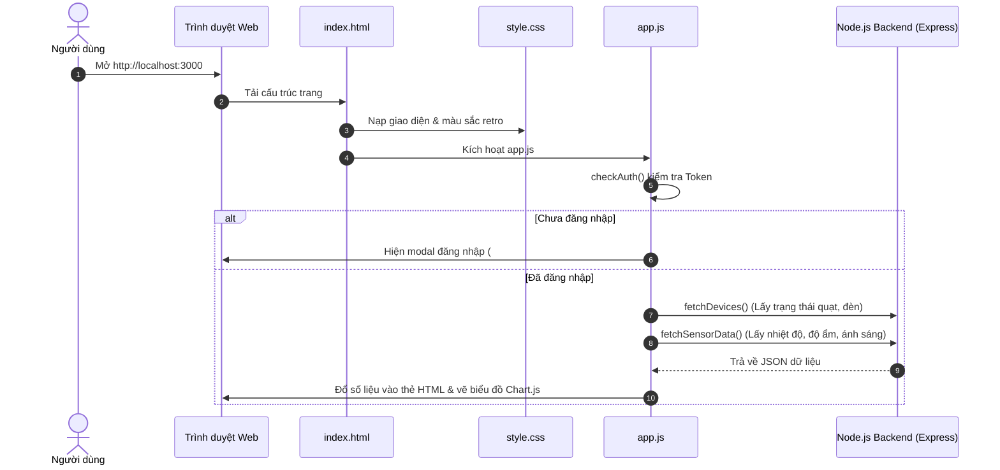

# HƯỚNG DẪN TỰ HỌC, ĐỌC HIỂU & ÔN THI SỬA CODE FRONTEND
> **Dành riêng cho Đồ án IoT Smart Home - B23DCAT266**  
> *Tài liệu đặc biệt biên soạn cho người mất gốc HTML/CSS/JS - Dễ hiểu, thực chiến, không lý thuyết suông.*

---

## MỤC LỤC
1. [Bức Tranh Tổng Thể Kiến Trúc Frontend](#1-bức-tranh-tổng-thể-kiến-trúc-frontend)
2. [Cheatsheet Các Thẻ HTML Thực Tế Trong Dự Án](#2-cheatsheet-các-thẻ-html-thực-tế-trong-dự-án)
3. [Cheatsheet Toàn Bộ Các Hàm JavaScript & Thành Phần](#3-cheatsheet-toàn-bộ-các-hàm-javascript--thành-phần)
4. [Kỹ Năng & Phương Pháp Tự Đọc Hiểu Code (Không Sợ Mất Gốc)](#4-kỹ-năng--phương-pháp-tự-đọc-hiểu-code)
5. [Bộ 10 Câu Hỏi Thầy Cô Hay Bắt Sửa Live-Code & Đáp Án Mẫu](#5-bộ-10-câu-hỏi-thầy-cô-hay-bắt-sửa-live-code--đáp-án-mẫu)

---

## 1. BỨC TRANH TỔNG THỂ KIẾN TRÚC FRONTEND

Frontend của dự án được tổ chức chuẩn theo mô hình **Separation of Concerns (Tách biệt mối quan tâm)** gồm 3 file:

```text
frontend/
├── index.html     --> KHUNG NHÀ (Khung xương, vị trí đặt cửa, bảng, công tắc)
├── css/style.css  --> SƠN TƯỜNG & NỘI THẤT (Màu sắc, kích thước, font, hiệu ứng gạt)
└── js/app.js      --> HỆ THỐNG ĐIỆN & NÃO BỘ (Nhận lệnh bấm, gọi API server, vẽ đồ thị)
```

### Luồng chạy thực tế khi người dùng mở Web (`http://localhost:3000`):


---

## 2. CHEATSHEET CÁC THẺ HTML THỰC TẾ TRONG DỰ ÁN

Dưới đây là các thẻ HTML đang chạy trong file `frontend/index.html`. Mỗi thẻ đều có vai trò cụ thể:

### 2.1. Thẻ Bố cục & Phân vùng (Layout)
| Thẻ HTML | Ý nghĩa dễ hiểu | Vị trí dùng trong dự án |
| :--- | :--- | :--- |
| `<div>` | Chiếc hộp vạn năng để gom nhóm nội dung. | Dùng ở khắp nơi: `.v-card` (thẻ nhiệt độ), `.chart-box`, `.panel-box` |
| `<aside>` | Khung bên lề (sidebar bên trái). | Thẻ `<aside class="sidebar">` chứa menu điều hướng 4 trang |
| `<nav>` | Khu vực chứa các liên kết menu. | Thẻ `<nav class="nav-links">` chứa 4 nút Dashboard, Cảm biến, Lịch sử, Profile |
| `<form>` | Khung biểu mẫu để người dùng nhập và gửi đi. | Form đăng nhập (dòng 23) và Form sửa hồ sơ cá nhân (dòng 248) |

### 2.2. Thẻ Văn bản & Nhãn
| Thẻ HTML | Ý nghĩa dễ hiểu | Vị trí dùng trong dự án |
| :--- | :--- | :--- |
| `<h1>`, `<h3>`, `<h5>` | Tiêu đề các cấp độ từ to đến nhỏ. | `<h1>Smart Home</h1>`, `<h3>Lịch sử Cảm biến</h3>`, `<h5>Nhiệt độ</h5>` |
| `<p>` | Đoạn văn bản mô tả thông thường. | `<p>Hệ thống Giám sát & Điều khiển Smart Home</p>` |
| `<span>` | Bọc một mẩu chữ nhỏ để tô màu hoặc định dạng riêng. | Huy hiệu trạng thái kết nối, nhãn icon, chữ hiển thị đơn vị `°C`, `%` |
| `<b>` | In đậm chữ (Bold). | `<b>admin</b>`, `<b>123456</b>` trong phần gợi ý đăng nhập |
| `<label>` | Nhãn chú thích cho một ô nhập liệu hoặc công tắc. | `<label>Tên đăng nhập</label>`, `<label class="switch">` |

### 2.3. Thẻ Biểu mẫu & Tương tác (Forms & Inputs) - *Rất hay bị hỏi*
| Thẻ & Thuộc tính | Ý nghĩa dễ hiểu | Ví dụ trong code |
| :--- | :--- | :--- |
| `<input type="text">` | Ô gõ văn bản 1 dòng. | `<input type="text" id="login-username">` |
| `<input type="password">` | Ô gõ mật khẩu (chấm tròn ẩn ký tự). | `<input type="password" id="login-password">` |
| `<input type="checkbox">` | Hộp kiểm tick chọn (dùng làm công tắc gạt). | `<input type="checkbox" id="dev-FAN_01" onchange="toggleDevice('FAN_01', this)">` |
| `<select>` & `<option>` | Menu thả xuống (Dropdown) để chọn 1 mục. | `<select id="filter-sensor-type">` để lọc Cảm biến Nhiệt độ / Độ ẩm / Ánh sáng |
| `<button>` | Nút bấm thực hiện hành động. | `<button type="submit">` (nút Login), `<button onclick="handleLogout()">` |
| `<a>` | Thẻ siêu liên kết (Link chuyển trang). | Thẻ link GitHub, Figma prototype trong phần Hồ sơ (`target="_blank"` để mở tab mới) |

### 2.4. Thẻ Bảng Dữ Liệu (Table) - *Trọng tâm đồ án IoT*
Cấu trúc bảng tuân thủ chặt chẽ thứ bậc:
```html
<table>                     <!-- Khởi tạo bảng -->
  <thead>                   <!-- Phần đầu bảng -->
    <tr>                    <!-- 1 dòng đầu bảng -->
      <th>ID</th>           <!-- Ô tiêu đề cột (in đậm, màu đen, cố định) -->
      <th>TÊN CẢM BIẾN</th>
    </tr>
  </thead>
  <tbody id="table-data">   <!-- Thân bảng: JS sẽ tự chèn các dòng <tr><td> vào đây -->
  </tbody>
</table>
```

### 2.5. Thẻ Đồ họa & Canvas
- `<canvas id="sensorChart"></canvas>`: Bức tranh trống để thư viện `Chart.js` vẽ đường biểu đồ nhiệt độ, độ ẩm theo thời gian thực.
- `<svg>`: Vẽ icon đồ họa vector (icon Dashboard, nhiệt kế, đồng hồ, user) bằng tọa độ toán học. Ưu điểm: cực kỳ nét, đổi màu dễ dàng, không sợ vỡ hình như file `.png`.

---

## 3. CHEATSHEET TOÀN BỘ CÁC HÀM JAVASCRIPT & THÀNH PHẦN

Toàn bộ logic nằm trong file [`frontend/js/app.js`](file:///D:/DESKTOP/DATA_DESKTOP/0-CODE/BTL_IOT/frontend/js/app.js). Khi thầy hỏi hàm nào làm gì, tra bảng này là trả lời được ngay:

| Tên Hàm | Vị trí dòng | Đầu vào (Tham số) | Chức năng chính | API gọi tới |
| :--- | :---: | :--- | :--- | :--- |
| `fmtTime(d)` | Dòng 8 | `d`: Ngày/giờ ISO | Chuyển đổi timestamp ISO sang dạng dễ đọc `dd/mm/yyyy hh:mm` | Không gọi |
| `badge(text, bg)` | Dòng 14 | `text`: Chữ, `bg`: Mã màu | Trả về chuỗi HTML nhãn có màu nền (ví dụ ON màu xanh, OFF màu đỏ) | Không gọi |
| `updatePagInfo(id, pag)` | Dòng 17 | `id`: ID thẻ, `pag`: Object phân trang | Cập nhật text "Hiển thị X-Y / Tổng bản ghi" | Không gọi |
| `checkAuth()` | Dòng 25 | Không có | Kiểm tra token trong `localStorage`. Nếu chưa có thì hiện popup đăng nhập | Không gọi |
| `handleLogin(e)` | Dòng 40 | `e`: Sự kiện submit form | Lấy username/pass, gửi xác thực, lưu token & chuyển vào Dashboard | `POST /api/auth/login` |
| `handleLogout()` | Dòng 72 | Không có | Xóa token & thông tin user khỏi `localStorage`, hiện lại popup login | Không gọi |
| `fetchProfile()` | Dòng 81 | Không có | Lấy thông tin họ tên, email, vai trò của tài khoản đang đăng nhập | `GET /api/profile` |
| `handleUpdateProfile(e)`| Dòng 100| `e`: Sự kiện submit | Gửi họ tên và email mới lên server để lưu vào Database | `PUT /api/profile` |
| `switchTab(tabId)` | Dòng 124| `tabId`: 'dashboard' / 'data' / 'history' / 'profile' | Ẩn tab cũ, hiện tab mới, đổi trạng thái active của menu sidebar | Không gọi |
| `toggleDevice(dev, el)` | Dòng 142| `deviceCode`: 'FAN_01'..., `checkboxEl`: Thẻ input | Gửi lệnh bật/tắt thiết bị xuống backend & phần cứng ESP8266 | `POST /api/v1/devices/toggle` |
| `fetchDevices()` | Dòng 161| Không có | Lấy trạng thái hiện tại của quạt và 2 đèn từ Database để gạt công tắc | `GET /api/devices` |
| `updateChart(data)` | Dòng 197| `data`: Object đo lường | Đẩy điểm đo mới vào biểu đồ, giới hạn 10 điểm gần nhất, gọi `sensorChart.update()` | Không gọi |
| `fetchSensorData()` | Dòng 209| Không có | Lấy nhiệt độ, độ ẩm, ánh sáng mới nhất để cập nhật thẻ Dashboard & biểu đồ | `GET /api/v1/sensors/data/latest` |
| `sortData(col)` | Dòng 225| `col`: Tên cột | Đảo chiều sắp xếp bảng cảm biến (ASC $\leftrightarrow$ DESC) rồi tải lại trang 1 | Không gọi |
| `resetSensorFilter()` | Dòng 232| Không có | Xóa trắng 3 ô lọc (loại cảm biến, giá trị, thời gian) về mặc định | Không gọi |
| `fetchDataSensor(page)` | Dòng 242| `page`: Số trang cần xem | Lấy dữ liệu cảm biến có phân trang, tìm kiếm & sắp xếp; đổ HTML vào `#table-data` | `GET /api/history/sensors` |
| `sortHist(col)` | Dòng 275| `col`: Tên cột | Đảo chiều sắp xếp bảng lịch sử thiết bị rồi tải lại trang 1 | Không gọi |
| `fetchActiveHistory(p)` | Dòng 282| `page`: Số trang cần xem | Lấy lịch sử thao tác bật/tắt có phân trang & tìm kiếm; đổ HTML vào `#table-hist` | `GET /api/history/actions` |
| `renderPaginationModern()`| Dòng 315| `containerId`, `pag`, `fetchFunc` | Sinh ra các nút phân trang chuẩn Figma: `< 1 2 3 4 5 >` | Không gọi |

---

## 4. KỸ NĂNG & PHƯƠNG PHÁP TỰ ĐỌC HIỂU CODE

Nếu bạn bị mất gốc HTML, hãy áp dụng đúng **3 nguyên tắc vàng** sau đây:

### Nguyên tắc 1: Phương pháp "Truy vết ID" (Trace ID)
Mọi sự kết nối giữa HTML và JavaScript đều thông qua thuộc tính `id`:
```text
HTML: <div class="value" id="val-temp">-- °C</div>
                             ▲
                             │ (Cùng 1 ID)
                             ▼
JS:   document.getElementById('val-temp').innerText = `${data.temperature} °C`;
```
- Khi muốn biết **"Chỗ này trên màn hình lấy dữ liệu từ đâu?"**:  
  $\rightarrow$ Mở `index.html`, tìm chữ trên màn hình xem nó nằm ở thẻ có `id` là gì.  
  $\rightarrow$ Sang `app.js`, bấm `Ctrl + F` tìm tên `id` đó. Bạn sẽ thấy ngay dòng code gán dữ liệu vào thẻ!

### Nguyên tắc 2: Tận dụng phím F12 (DevTools)
Khi chạy web trên trình duyệt Chrome/Edge, hãy bấm phím **F12**:
1. **Tab Elements (Mũi tên chỉ trỏ)**: Bấm vào icon mũi tên góc trên bên trái, chỉ vào bất kỳ nút bấm hay ô chữ nào trên web. Bạn sẽ thấy ngay nó là thẻ HTML gì, class nào, style màu gì ở cột bên phải.
2. **Tab Console**: Nơi xem lỗi. Nếu bấm nút không thấy phản hồi, mở Console xem có dòng chữ màu đỏ nào không.
3. **Tab Network**: Bấm lọc `Fetch/XHR`. Khi bạn gạt công tắc quạt hoặc bấm nút tìm kiếm, bạn sẽ thấy 1 dòng yêu cầu gửi đi. Bấm vào dòng đó xem được:
   - Request URL: Gửi đi đâu?
   - Payload: Gửi tham số gì?
   - Response: Server trả về JSON gì?

### Nguyên tắc 3: Hiểu đúng bản chất của JavaScript
JavaScript trong dự án này chỉ làm đúng 3 việc lặp đi lặp lại:
1. **Lắng nghe sự kiện**: Khi người dùng bấm (`onclick`), gõ phím (`oninput`), gạt công tắc (`onchange`), hoặc bấm form (`onsubmit`).
2. **Gọi API bằng `fetch()`**: Gửi dữ liệu về backend và nhận kết quả JSON.
3. **Thay đổi màn hình**: Dùng `document.getElementById(...).innerText = ...` hoặc `.innerHTML = ...` để hiển thị dữ liệu mới ra web.

---

## 5. BỘ 10 CÂU HỎI THẦY CÔ HAY BẮT SỬA LIVE-CODE & ĐÁP ÁN MẪU

Dưới đây là các câu hỏi kinh điển giảng viên hay dùng để kiểm tra sinh viên có thực sự hiểu code hay không:

---

### Câu 1: "Thầy muốn đổi màu nền của web từ màu giấy cũ sang màu trắng tinh hoặc xám nhạt, sửa ở đâu?"
- **Nơi sửa**: File [`frontend/css/style.css`](file:///D:/DESKTOP/DATA_DESKTOP/0-CODE/BTL_IOT/frontend/css/style.css), dòng 2 - 8.
- **Cách làm**: Sửa biến `--bg-color` trong `:root`:
  ```css
  /* Đổi từ màu cũ #f4ecd8 sang màu trắng #ffffff hoặc xám #f5f5f5 */
  :root {
      --bg-color: #ffffff; /* hoặc #f5f5f5 */
  }
  ```

---

### Câu 2: "Thầy muốn đổi thời gian tự động cập nhật biểu đồ từ 3 giây thành 5 giây, sửa dòng nào?"
- **Nơi sửa**: File [`frontend/js/app.js`](file:///D:/DESKTOP/DATA_DESKTOP/0-CODE/BTL_IOT/frontend/js/app.js), dòng cuối cùng (dòng 336).
- **Cách làm**:
  ```javascript
  // Đổi 3000 (3 giây) thành 5000 (5 giây)
  setInterval(fetchSensorData, 5000);
  ```

---

### Câu 3: "Mặc định mỗi trang đang hiện 10 bản ghi, em chỉnh lại cho hiển thị 20 bản ghi mỗi trang xem nào?"
- **Nơi sửa**: File [`frontend/js/app.js`](file:///D:/DESKTOP/DATA_DESKTOP/0-CODE/BTL_IOT/frontend/js/app.js), dòng 4 và dòng 5.
- **Cách làm**: Sửa thuộc tính `limit` từ `10` thành `20`:
  ```javascript
  let dataState = { page: 1, limit: 20, sortBy: 'id', sortOrder: 'ASC' };
  let histState = { page: 1, limit: 20, sortBy: 'id', sortOrder: 'DESC' };
  ```

---

### Câu 4: "Giờ thầy muốn thêm 1 thiết bị mới: 'Đèn Sân Vườn' (mã LED_03), em thêm công tắc vào đâu?"
- **Nơi sửa**: File [`frontend/index.html`](file:///D:/DESKTOP/DATA_DESKTOP/0-CODE/BTL_IOT/frontend/index.html), trong khối `.control-box` (khoảng dòng 120).
- **Cách làm**: Copy 1 thẻ `.device-card` có sẵn và đổi tên + ID:
  ```html
  <div class="device-card">
      <span>Đèn Sân Vườn</span>
      <label class="switch">
          <input type="checkbox" id="dev-LED_03" onchange="toggleDevice('LED_03', this)">
          <span class="slider"></span>
      </label>
  </div>
  ```

---

### Câu 5: "Biểu đồ đường hiện tại chỉ giữ 10 điểm đo gần nhất, sửa cho nó lưu 20 điểm đo xem?"
- **Nơi sửa**: File [`frontend/js/app.js`](file:///D:/DESKTOP/DATA_DESKTOP/0-CODE/BTL_IOT/frontend/js/app.js), hàm `updateChart()` (dòng 203).
- **Cách làm**: Đổi số `10` thành `20`:
  ```javascript
  if (sensorChart.data.labels.length > 20) {
      sensorChart.data.labels.shift();
      sensorChart.data.datasets.forEach(d => d.data.shift());
  }
  ```

---

### Câu 6: "Thầy muốn đổi thứ tự sắp xếp mặc định của Lịch sử cảm biến: bản ghi mới nhất phải hiện lên đầu tiên?"
- **Nơi sửa**: File [`frontend/js/app.js`](file:///D:/DESKTOP/DATA_DESKTOP/0-CODE/BTL_IOT/frontend/js/app.js), dòng 4.
- **Cách làm**: Đổi `sortOrder: 'ASC'` (tăng dần) thành `'DESC'` (giảm dần):
  ```javascript
  let dataState = { page: 1, limit: 10, sortBy: 'id', sortOrder: 'DESC' };
  ```

---

### Câu 7: "Tại sao tiêu đề các cột của em cuộn chuột xuống mà nó không bị trôi mất?"
- **Đáp án trả lời thầy**:  
  *"Thưa thầy, trong file `style.css` ở thẻ `th`, em sử dụng thuộc tính `position: sticky; top: 0; z-index: 2;`. Thuộc tính này biến hàng tiêu đề thành dạng dính cố định vào mép trên của khung chứa `.table-wrapper` khi người dùng cuộn dữ liệu."*

---

### Câu 8: "Cơ chế đăng nhập và giữ phiên làm việc ở Frontend hoạt động như thế nào?"
- **Đáp án trả lời thầy**:  
  *"Thưa thầy, khi người dùng nhập tài khoản ở hàm `handleLogin()`, Frontend gửi yêu cầu `POST /api/auth/login`. Nếu thành công, Server trả về một chuỗi `token`. Em lưu token này vào bộ nhớ trình duyệt bằng lệnh `localStorage.setItem('token', data.token)`. Ở các lần gọi API sau (như cập nhật hồ sơ, điều khiển thiết bị), em gửi kèm token này trong Header `Authorization: Bearer <token>`. Khi mở lại trang web, hàm `checkAuth()` sẽ đọc `localStorage` để biết người dùng đã đăng nhập hay chưa."*

---

### Câu 9: "Khi em bấm bật công tắc quạt, luồng dữ liệu đi như thế nào tới phần cứng?"
- **Đáp án trả lời thầy**:  
  *"Thưa thầy, khi người dùng gạt công tắc:
  1. Thẻ input kích hoạt sự kiện `onchange="toggleDevice('FAN_01', this)"`.
  2. Hàm `toggleDevice()` gửi `POST /api/v1/devices/toggle` với body `{ deviceCode: "FAN_01", action: "ON" }`.
  3. Backend nhận lệnh, cập nhật bảng `devices`, ghi vào nhật ký `action_history`, đồng thời gọi `mqttService.publishDeviceControl()` để bắn gói tin MQTT có topic `esp8266/control/FAN_01` với payload `ON`.
  4. Mạch ESP8266 đăng ký topic này nhận được lệnh và đóng rơ-le kích hoạt quạt thật."*

---

### Câu 10: "Hàm `switchTab()` chuyển qua lại giữa các trang như thế nào khi dự án chỉ có 1 file `index.html`?"
- **Đáp án trả lời thầy**:  
  *"Thưa thầy, đây là kỹ thuật Single Page Application (SPA) đơn giản. Cả 4 trang (Dashboard, Cảm biến, Lịch sử, Hồ sơ) đều nằm trong `index.html` dưới dạng các thẻ `div class="page-view"`. Mặc định trong CSS, `.page-view { display: none; }` (bị ẩn đi). Khi người dùng bấm tab nào, hàm `switchTab()` sẽ xóa class `active` ở các trang khác và thêm class `active` vào trang được chọn. Trong CSS, `.page-view.active { display: flex; }` giúp trang đó hiện lên mà không cần tải lại toàn bộ trình duyệt."*

---

## 📌 LỜI KHUYÊN DÀNH CHO BẠN KHI ĐI BẢO VỆ
1. Hãy mở sẵn Visual Studio Code với 3 tab: `index.html`, `style.css`, và `app.js`.
2. Khi thầy bảo sửa gì, **bình tĩnh xác định xem câu hỏi thuộc loại nào**:
   - Về màu sắc, font, kích thước $\rightarrow$ Bấm sang tab `style.css`.
   - Về thêm thẻ, đổi chữ hiển thị $\rightarrow$ Bấm sang tab `index.html`.
   - Về thời gian, gọi API, số dòng phân trang $\rightarrow$ Bấm sang tab `app.js`.
3. Nhớ bấm `Ctrl + S` để lưu sau khi sửa và bấm `F5` trên trình duyệt để thấy kết quả ngay lập tức!
