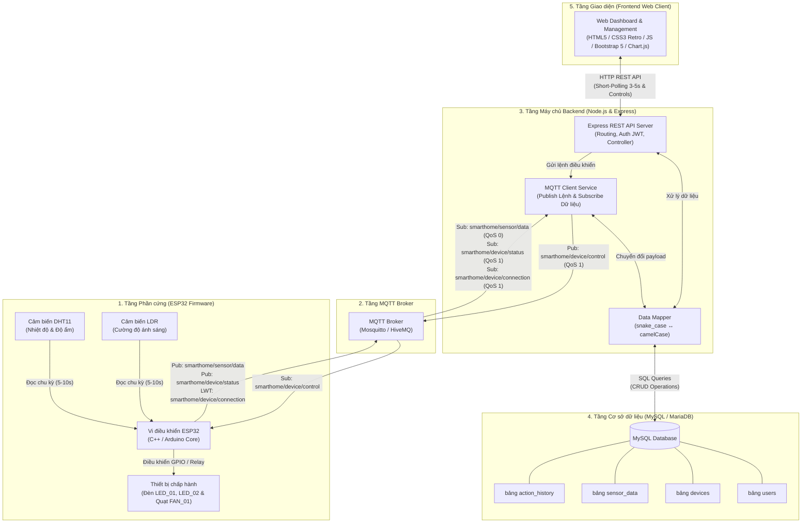
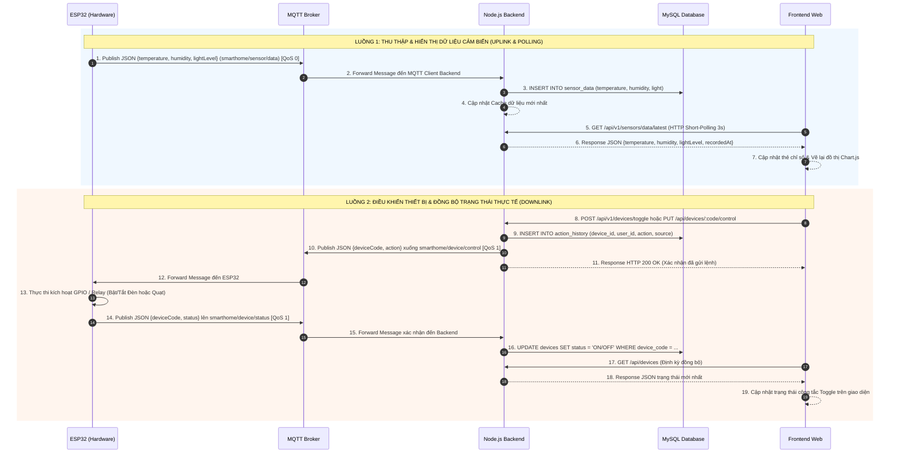

# SƠ ĐỒ TỔNG THỂ HỆ THỐNG IOT SMART HOME

Tài liệu mô tả chi tiết **Kiến trúc tổng thể hệ thống IoT Smart Home**, bao gồm sơ đồ thành phần 5 tầng chuẩn hóa, sơ đồ luồng dữ liệu truyền nhận (Sequence Diagram), cùng giải thích chức năng chi tiết của từng khối trong hệ thống.

---

## 1. Sơ đồ Kiến trúc Tổng thể (Overall Architecture Diagram)

---

## 2. Sơ đồ Luồng Truyền Nhận Dữ Liệu (Sequence Diagram)

Sơ đồ thể hiện 2 luồng tương tác chính trong hệ thống: **Ghi nhận số liệu cảm biến** và **Điều khiển thiết bị & Đồng bộ trạng thái thực tế**.

---

## 3. Diễn giải Chi tiết Các Khối Thành Phần

### 3.1. Tầng Phần cứng (ESP32 Firmware)
* **Cảm biến:** 
  * `DHT11`: Đo nhiệt độ (°C) và độ ẩm (%).
  * `LDR (Quang trở)`: Đo cường độ ánh sáng (lux).
* **Thiết bị chấp hành:** `Đèn LED_01`, `Đèn LED_02` và `Quạt FAN_01` kết nối qua các chân GPIO / Module Relay của ESP32.
* **Tác vụ chính:** 
  * Định kỳ 5–10 giây đọc cảm biến và gộp thành 1 payload JSON duy nhất gửi lên `smarthome/sensor/data` (giảm tải số lượng message gửi lên Broker).
  * Lắng nghe lệnh điều khiển từ `smarthome/device/control` để bật/tắt đúng thiết bị.
  * Phản hồi trạng thái thực tế sau khi kích hoạt phần cứng lên `smarthome/device/status`.
  * Đăng ký cơ chế **Last Will and Testament (LWT)** tại topic `smarthome/device/connection` để thông báo trạng thái Online/Offline khi mất nguồn/mất mạng đột ngột.

### 3.2. Tầng MQTT Broker
* Trung gian truyền nhận message giữa ESP32 và Node.js Backend theo mô hình Publish/Subscribe.
* Sử dụng **QoS 0** cho dữ liệu cảm biến (tần suất gửi lặp lại liên tục) và **QoS 1** cho các lệnh điều khiển / xác nhận trạng thái (đảm bảo không bị thất lạc lệnh quan trọng).

### 3.3. Tầng Máy chủ Backend (Node.js & Express)
* **Express REST API Server:** Cung cấp các endpoint theo chuẩn RESTful cho Frontend:
  * `POST /api/auth/login`: Đăng nhập, cấp JWT token (hạn 24h).
  * `GET /api/devices` & `PUT /api/devices/:deviceCode/control`: Quản lý và điều khiển thiết bị.
  * `GET /api/sensors/latest` (hoặc `/api/v1/sensors/data/latest`): Lấy dữ liệu cảm biến mới nhất phục vụ polling.
  * `GET /api/history/sensors`: Lịch sử dữ liệu cảm biến (hỗ trợ tìm kiếm đa cột, sắp xếp ASC/DESC, phân trang 50 dòng/trang).
  * `GET /api/history/actions`: Lịch sử hoạt động bật/tắt thiết bị (phân trang 20 dòng/trang).
  * `GET /api/profile` & `PUT /api/profile`: Xem và cập nhật hồ sơ cá nhân.
  * Phục vụ static file Frontend Web và tài liệu Swagger UI tại `/api-docs`.
* **MQTT Client Service:** Lắng nghe dữ liệu cảm biến từ ESP32 để lưu vào Database, đồng thời phát lệnh điều khiển xuống ESP32 khi có yêu cầu từ API.
* **Data Mapper:** Chuyển đổi định dạng tên giữa `snake_case` (trong MySQL) và `camelCase` (trong JSON API & MQTT).

### 3.4. Tầng Cơ sở dữ liệu (MySQL / MariaDB)
Lưu trữ **4 bảng chính** có ràng buộc khóa ngoại (Foreign Key) và chỉ mục (Index) tối ưu:
1. `users`: Quản lý tài khoản, mật khẩu (mã hóa Bcrypt), vai trò (`admin`/`user`).
2. `devices`: Quản lý danh mục thiết bị (`LED_01`, `LED_02`, `FAN_01`), vị trí và trạng thái thực tế (`ON`/`OFF`).
3. `sensor_data`: Thiết kế dạng phẳng (**Flattened Schema**: `id`, `temperature`, `humidity`, `light`, `recorded_at`) có đánh Index trường thời gian, tối ưu hóa truy vấn hiển thị bảng 5 cột.
4. `action_history`: Lưu nhật ký mọi hành động bật/tắt thiết bị (liên kết với `devices` và `users`).

### 3.5. Tầng Giao diện (Frontend Web Client)
* Xây dựng theo kiến trúc Single Page Application (SPA) bằng HTML5, CSS3 Retro/Vintage, JavaScript thuần và thư viện đồ thị Chart.js.
* **Cơ chế Cập nhật dữ liệu (Near Real-time):** Sử dụng **HTTP Short-Polling** (gọi API định kỳ 3 giây qua `setInterval`) để tự động làm mới thẻ thông số, vẽ lại đồ thị Chart.js và đồng bộ công tắc bật/tắt mà không cần tải lại trang.
